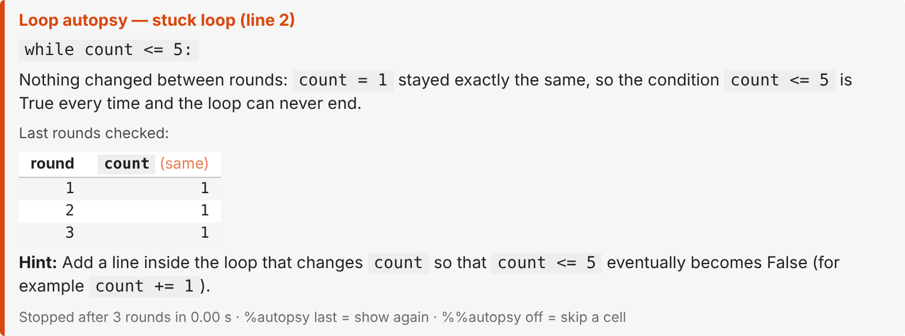

# loop-autopsy

**Stops runaway loops in Jupyter and shows the evidence for why they never ended.**

```python
%load_ext loop_autopsy

count = 1
while count <= 5:
    print(count)
```

Instead of freezing the notebook, the loop is stopped after 3 rounds and you get:



```
Loop autopsy — stuck loop (line 2)
    while count <= 5:

Nothing changed between rounds: `count = 1` stayed exactly the same, so the
condition `count <= 5` is True every time and the loop can never end.

Last rounds checked:
round  count (same)
-----  ------------
1      1
2      1
3      1

Hint: Add a line inside the loop that changes `count` so that `count <= 5`
eventually becomes False (for example `count += 1`).
```

---

## Motivation

Every beginner writes an infinite loop. In a notebook on a shared JupyterHub this
is worse than it sounds:

- the cell hangs with no explanation, and the only remedy is the stop button ■;
- a `print` inside the loop floods the browser with output until the tab freezes;
- the loop keeps using CPU and memory on a server shared by the whole class.

Pressing ■ stops the loop but teaches nothing. The student still does not know
*which* variable failed to change or *why* the condition never became False.

## Innovation

loop-autopsy watches loops **while they run** and stops them only when it can
**prove** they will never end. Then it shows the evidence.

| | Stops a stuck loop? | Explains *why*? | When? |
|---|---|---|---|
| Stop button ■ | yes (you press it) | no | whenever you notice |
| Timeout decorators (e.g. `wrapt_timeout_decorator`) | yes, after a fixed time | no | after the time limit |
| Error explainers (e.g. `friendly-traceback`) | no | explains *errors*, but an infinite loop raises none | after a crash |
| Memory monitors (e.g. `jupyter-resource-usage`) | no | no | shows totals only |
| **loop-autopsy** | **yes, automatically** | **yes, with a replay table** | **during the loop, often after 3 rounds** |

How it works, in short:

1. An IPython **AST transformer** (it edits the code's syntax tree before it runs)
   adds a tiny check to every `while` and `for` loop you type in a cell.
2. Each check takes a **fingerprint** of the loop's variables. If a deterministic
   loop comes back to an *exactly identical* state, it must repeat forever: that
   is a proof, not a guess.
3. Further rules catch a counter moving *away* from its target, a `!=` condition
   that jumps over its stop value (`0.1 + 0.1 + ...` never equals `1.0`), a list
   that grows while you loop over it, and memory running out.
4. Anything it cannot prove falls back to an honest time limit. No AI model, no
   internet, and the same result every time.

Every rule and its numbers are listed below, and every number can be changed (see Settings).

## What it detects

| Pattern | Example | Stopped after |
|---|---|---|
| **Stuck**: nothing changes | `while count <= 5: print(count)` | 3 rounds |
| **Cycle**: values go round in a circle | `while a < 5: a = (a + 1) % 3` | about 2 cycles |
| **Wrong direction** | `while i < 10: i -= 1` | 500 checks |
| **Jumped over** the stop value | `while x != 1.0: x += 0.1` | about 100 checks |
| **Growing list** in a `for` loop | `for n in nums: nums.append(n)` | 2,000 rounds |
| **Memory** about to run out | a loop filling a huge list | at 85% of the limit |
| **Too long** (fallback) | anything else | 60 s |

Plus three extras:

- **Press ■ yourself** and you still get the replay table, showing which
  variables never changed.
- **Cell health bar**: time, memory and loops for a cell, coloured green / yellow /
  red. It warns when memory passes 75% of your limit and names the biggest
  variables (pandas and NumPy aware). It also mutes output after 1,000 printed
  lines so the browser stays responsive.
- **Session summary**: `%autopsy summary` shows every cell you have run as a strip
  of coloured squares, then a table of the heaviest cells with their time, memory
  and stopped loops. Here a cell is coloured only by what it did itself (its run
  time and the memory it added), so one big dataframe does not turn every later
  cell red. The health bar is different: it colours by total memory in use, to
  warn you when you are close to the limit.

## Example use cases

- **Students** in an intro course: load it once at the top of every notebook and
  never lose a session to a frozen loop again.
- **Instructors** on JupyterHub: load it for everyone (see below) to protect the
  shared server and turn every infinite loop into a mini-lesson.
- **Teaching assistants**: the replay table shows at a glance what went wrong in
  a student's loop.
- **Data notebooks**: the health bar shows which cell is slow or memory-hungry.

## Setup

```bash
pip install loop-autopsy
```

The only requirement is IPython (already present in Jupyter). Python 3.9+.

In a notebook:

```python
%load_ext loop_autopsy
```

**For instructors**: to turn it on for every notebook, add this to the IPython
profile (`~/.ipython/profile_default/ipython_config.py`):

```python
c.InteractiveShellApp.extensions = ["loop_autopsy"]
```

## Usage

| Command | Effect |
|---|---|
| `%autopsy` | status and settings |
| `%autopsy on` / `off` | start / stop watching loops |
| `%autopsy last` | show the last report again |
| `%autopsy heatmap on` / `off` / `auto` | cell health bar (`auto` = only when a cell is slow or memory-heavy) |
| `%autopsy summary` | the 10 heaviest cells of this session, worst first |
| `%autopsy summary all` / `clear` | every cell in run order / forget the history |
| `%autopsy config time_limit=120` | change a setting (see Settings below) |
| `%%autopsy off` | first line of a cell: run that cell without watching |
| `%autopsy help` | help |

Cells that use `%timeit` / `%%timeit` are never watched, so timings stay accurate.
Loops inside generators (`yield`) are left alone, because infinite generators are
normal.

Try [examples/demo.ipynb](examples/demo.ipynb) for every feature in one notebook.

## Settings

Change any of these with `%autopsy config key=value` (for example `%autopsy config time_limit=120`).

| Setting | Default | Meaning |
|---|---|---|
| `time_limit` | 60 | seconds before a loop that cannot be proven stuck is stopped (0 = never) |
| `direction_after` | 500 | checks in a row moving away from the stop value before "wrong direction" |
| `jump_after` | 100 | checks in a row after jumping over a `!=` stop value |
| `growth_after` | 2000 | rounds before a growing list in a `for` loop is reported |
| `memory_stop` | 0.85 | stop a loop when memory reaches this fraction of the limit |
| `memory_warn` | 0.75 | health bar warning at this fraction of the limit |
| `max_output_lines` | 1000 | printed lines per cell before output is muted (0 = off) |
| `replay_rows` | 6 | rows in the replay table |
| `max_watched` | 25 | variables watched per loop |
| `heatmap` | `auto` | `on`, `off` or `auto` |
| `time_yellow` / `time_red` | 1.0 / 10.0 | seconds for a yellow / red health bar |
| `mem_yellow` / `mem_red` | 0.50 / 0.80 | memory fraction for a yellow / red health bar |
| `history_cells` | 200 | cells remembered for `%autopsy summary` (0 = off) |
| `grow_yellow` / `grow_red` | 0.05 / 0.20 | summary: memory one cell added, as a fraction of the limit, for a yellow / red square |

The summary also uses `time_yellow` / `time_red` for a cell's run time. Its history
lives in memory only and is gone when the kernel restarts.

The memory limit is read from JupyterHub's `MEM_LIMIT` setting, then the container's
memory limit, then the computer's total RAM.

## Limitations (honest list)

- No tool can detect *every* infinite loop (the halting problem). loop-autopsy
  only reports a stuck, cycling, wrong-direction or jumped-over loop when it can
  prove it; everything else gets the time limit.
- Loops that call your own functions or modules such as `random` cannot be proven
  stuck (those calls might change hidden state), so they rely on the time limit.
- Only code typed in notebook cells is watched, not code inside imported modules.
- Watching adds a small cost to each loop round (roughly 0.1–0.2 µs per round on
  simple loops). Use `%%autopsy off` for heavy number crunching.
- A bare `except:` inside a loop can catch the stop signal, just as it catches ■.

## Development

```bash
git clone https://github.com/Geoeoeo217/loop-autopsy
cd loop-autopsy
pip install -e ".[test]"
pytest
```

## Team

Built by a team of five for CS1302 (Introduction to Computer Programming).

| Member | Part |
|---|---|
| NATHANAEL George Steindhart | project lead: loop rewriting (`transformer.py`), run-time glue (`monitor.py`), magics, packaging |
| SETIAWAN Matthew Henson | detection rules: stuck, cycle, wrong direction, jumped over, time limit (`detectors.py`) |
| LATHIF Muhammad Akmal | memory and growing-list rules (`growth.py`) |
| KWAN Kendrick Matthew | replay table and reports (`report.py`) |
| HANDAYA Clement Steward | cell health bar and output guard (`heatmap.py`) |


## License

MIT
