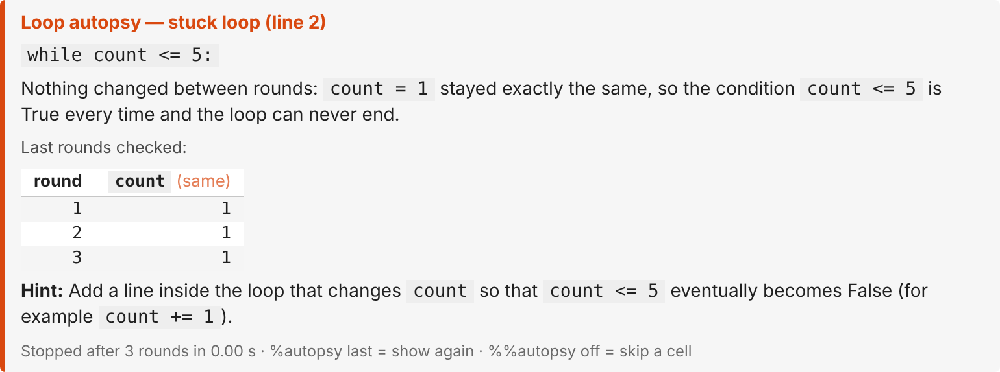

# loop-autopsy

[](https://github.com/Geoeoeo217/loop-autopsy/actions/workflows/tests.yml)

**Stops runaway loops in Jupyter and shows the evidence for why they never ended.**

```python
%load_ext loop_autopsy

count = 1
while count <= 5:
    print(count)
```

Instead of freezing the notebook, the loop is stopped after 3 rounds and you get:



```
Loop autopsy — stuck loop (line 2)
    while count <= 5:

Nothing changed between rounds: `count = 1` stayed exactly the same, so the
condition `count <= 5` is True every time and the loop can never end.

Last rounds checked:
round  count (same)
-----  ------------
1      1
2      1
3      1

Hint: Add a line inside the loop that changes `count` so that `count <= 5`
eventually becomes False (for example `count += 1`).
```

---

## Motivation

Every beginner writes an infinite loop. In a notebook on a shared JupyterHub this
is worse than it sounds:

- the cell hangs with no explanation, and the only remedy is the stop button ■;
- a `print` inside the loop floods the browser with output until the tab freezes;
- the loop keeps using CPU and memory on a server shared by the whole class.

Pressing ■ stops the loop but teaches nothing. The student still does not know
*which* variable failed to change or *why* the condition never became False.

## Innovation

loop-autopsy watches loops **while they run** and stops them only when it can
**prove** they will never end. Then it shows the evidence.

| | Stops a stuck loop? | Explains *why*? | When? |
|---|---|---|---|
| Stop button ■ | yes (you press it) | no | whenever you notice |
| Timeout decorators (e.g. `wrapt_timeout_decorator`) | yes, after a fixed time | no | after the time limit |
| Error explainers (e.g. `friendly-traceback`) | no | explains *errors*, but an infinite loop raises none | after a crash |
| Memory monitors (e.g. `jupyter-resource-usage`) | no | no | shows totals only |
| **loop-autopsy** | **yes, automatically** | **yes, with a replay table** | **during the loop, often after 3 rounds** |

How it works, in short:

1. An IPython **AST transformer** (it edits the code's syntax tree before it runs)
   adds a tiny check to every `while` and `for` loop you type in a cell.
2. Each check takes a **fingerprint** of the loop's variables. If a deterministic
   loop comes back to an *exactly identical* state, it must repeat forever: that
   is a proof, not a guess.
3. Further rules catch a counter moving *away* from its target, a `!=` condition
   that jumps over its stop value (`0.1 + 0.1 + ...` never equals `1.0`), a list
   that grows while you loop over it, and memory running out.
4. Anything it cannot prove falls back to an honest time limit. No AI model, no
   internet, and the same result every time.

Every rule and its numbers are listed below, and every number can be changed (see Settings).

## What it detects

| Pattern | Example | Stopped after |
|---|---|---|
| **Stuck**: nothing changes | `while count <= 5: print(count)` | 3 rounds |
| **Cycle**: values go round in a circle | `while a < 5: a = (a + 1) % 3` | about 2 cycles |
| **Wrong direction** | `while i < 10: i -= 1` | 500 checks |
| **Jumped over** the stop value | `while x != 1.0: x += 0.1` | about 100 checks |
| **Growing list** in a `for` loop | `for n in nums: nums.append(n)` | 2,000 rounds |
| **Memory** about to run out | a loop filling a huge list | at 85% of the limit |
| **Would take too long**: a `for` loop over something with a length, too slow to finish in time | `for row in range(10**9): slow(row)` | 5 s, if it needs at least twice the time limit |
| **Too long** (fallback) | anything else | 60 s |
| **Runaway recursion** | `def f(n): return f(n - 2)` | when Python raises `RecursionError` |

A `for` loop that "would take too long" is stopped with an estimate ("finished
1,234 of 10,000,000 rounds; at this speed it needs about 11 hours") instead of a
minute of waiting, because the time limit would stop it anyway. This only
happens when the loop has no `break`, `return` or `raise`: a search that may end
early is given the full time limit. A loop stopped by the time limit also shows
how far it got, when its length is known.

A `while True:` loop with no `break`, `return`, `raise` or `exit()` inside gets
a one-line note as soon as it starts, because it can only end with an error.

Three more mistakes are read straight from the code:

- **Update line after the loop.** When the line right after a `while` loop
  changes a variable of its condition and nothing inside the loop does, the
  hint names that line and asks whether it should be indented:
  `Line 4 (count += 1) changes count, but it comes after the loop`. The hint
  is left out when the loop has a `break`, `return` or `raise`, or calls a
  function of your own that could change the variable.
- **Endless iterator.** A `for` loop over `itertools.count()`,
  `itertools.cycle(...)` or `itertools.repeat(x)` with no `break`, `return` or
  `raise` gets a note on its first round, since it can only end with an error.
- **Catch-all `except`.** A bare `except:` or `except BaseException:` also
  catches the stop button ■ and loop-autopsy's stop signal. Inside a loop, the
  note says ■ will only jump to the `except` block. Around a loop, it says a
  stopped loop's report will be hidden (`%autopsy last` still shows it). There
  is no note when the `except` block re-raises, or, inside a loop, when it
  leaves the loop.

Runaway recursion is the recursive cousin of an infinite loop. Python already
stops it, but with a traceback hundreds of lines long. loop-autopsy replaces that
with a report: which function kept calling itself (or which functions kept
calling each other), its arguments in the first and last calls, and why the base
case was never reached. It tells apart arguments that never change, arguments
that go round in a circle, a value that jumped past 0, a value moving the wrong
way, and a function that may be correct but needs more depth than Python allows.

Plus four extras:

- **Press ■ yourself** and you still get the replay table, showing which
  variables never changed.
- **Cell health bar**: time, memory and loops for a cell, coloured green / yellow /
  red. It warns when memory passes 75% of your limit and names the biggest
  variables (pandas and NumPy aware); `%autopsy memory` shows the same list
  whenever you ask. It also notices a cell that adds memory **every time you
  re-run it** (such as `df = pd.concat([df, new])`): after two such re-runs in a
  row, each adding 10 MB or more, it explains why and what to do.
- **Output guard**: a cell's output is muted after 1,000 printed lines, so the
  browser stays responsive. This covers `print`, error output (`sys.stderr`) and,
  after 200 items, `display()` (tables, plots). The last 20 muted lines are shown
  when the cell ends (or just before its error message), because the end of the
  output is usually the part you need. Animations that clear the output and
  redraw are not muted, because `clear_output()` starts the count again.
- **Session summary**: `%autopsy summary` shows every cell you have run as a strip
  of coloured squares, then a table of the heaviest cells with their time, memory
  and stopped loops. Here a cell is coloured only by what it did itself (its run
  time and the memory it added), so one big dataframe does not turn every later
  cell red. The health bar is different: it colours by total memory in use, to
  warn you when you are close to the limit.

## Example use cases

- **Students** in an intro course: load it once at the top of every notebook and
  never lose a session to a frozen loop again.
- **Instructors** on JupyterHub: load it for everyone (see below) to protect the
  shared server and turn every infinite loop into a mini-lesson.
- **Teaching assistants**: the replay table shows at a glance what went wrong in
  a student's loop.
- **Data notebooks**: the health bar shows which cell is slow or memory-hungry.

## Setup

```bash
pip install loop-autopsy
```

The only requirement is IPython (already present in Jupyter). Python 3.9+.

In a notebook:

```python
%load_ext loop_autopsy
```

**For instructors**: to turn it on for every notebook, add this to the IPython
profile (`~/.ipython/profile_default/ipython_config.py`):

```python
c.InteractiveShellApp.extensions = ["loop_autopsy"]
```

## Usage

| Command | Effect |
|---|---|
| `%autopsy` | status and settings |
| `%autopsy on` / `off` | start / stop watching loops |
| `%autopsy last` | show the last report again |
| `%autopsy heatmap on` / `off` / `auto` | cell health bar (`auto` = only when a cell is slow or memory-heavy) |
| `%autopsy summary` | the 10 heaviest cells of this session, worst first |
| `%autopsy summary all` / `clear` | every cell in run order / forget the history |
| `%autopsy memory` / `%autopsy memory 10` | memory in use, the 5 (or N) biggest variables with their sizes and share of your limit, and big results that the output history (`Out`, `_`) still keeps alive after you `del` the variable |
| `%autopsy config time_limit=120` | change a setting (see Settings below) |
| `%autopsy reset` | put every setting back to its default, and list the ones that changed |
| `%%autopsy off` | first line of a cell: run that cell without watching |
| `%autopsy help` | help |

Cells that use `%timeit` / `%%timeit` are never watched, so timings stay accurate.
Loops inside generators (`yield`) are left alone, because infinite generators are
normal.

Try [examples/demo.ipynb](examples/demo.ipynb) for every feature in one notebook.

### Compare variable sizes across cells

To see which variables grew while a cell ran, load the optional extension and
save a checkpoint before running the code you want to measure:

```python
%load_ext loop_autopsy.growth_diff
samples = bytearray(1024)
%growthdiff mark
```

In the next cell, grow the buffer and display the changes:

```python
samples.extend(bytes(4096))
%growthdiff show
```

The report lists `samples` as `grew` and shows its estimated increase in bytes.
New, removed and shrinking variables also appear, ordered by absolute size
change. Estimates are per variable name, so two names for the same object can
both appear. An object whose name was removed may still be held by another name or
by the notebook's output history.

| Command | Effect |
|---|---|
| `%growthdiff mark` | Save the current names and estimated sizes as the new checkpoint. |
| `%growthdiff` or `%growthdiff show` | Show up to 10 changes since the checkpoint. Repeated calls use the same checkpoint. |
| `%growthdiff show 3` | Show the three largest changes. Use any positive integer. |
| `%growthdiff clear` | Discard the checkpoint. |

### Inspect a variable's memory use

Load the optional memory inspection commands once per notebook:

```python
%load_ext loop_autopsy.memory_inspect
batch = {"metadata": "train", "pixels": bytearray(8192)}
preview = batch
%memaliases batch
%memparts batch
```

**`%memaliases NAME`** lists visible notebook names pointing to that exact object.
In the example, both `batch` and `preview` appear. If an output in IPython's
`Out` cache holds the object directly, its cell number appears too. References
inside containers and shared buffers between separate objects are outside the scan.

**`%memparts NAME [N]`** ranks the immediate values in a built-in dict, list or
tuple by estimated size. In the example, `batch['pixels']` ranks first.
It inspects the first 64 entries in iteration order and shows the largest five
among them by default. Use `%memparts batch 2` to show two. Each row measures
one value using the same estimator as `%autopsy memory`. Shared values can
appear more than once, and container overhead is excluded from the rows.

## Settings

Change any of these with `%autopsy config key=value` (for example `%autopsy config time_limit=120`).

| Setting | Default | Meaning |
|---|---|---|
| `time_limit` | 60 | seconds before a loop that cannot be proven stuck is stopped (0 = never) |
| `estimate_after` | 5 | seconds before a `for` loop's total time is estimated, to stop it early if it needs at least twice `time_limit` (0 = never) |
| `direction_after` | 500 | checks in a row moving away from the stop value before "wrong direction" |
| `jump_after` | 100 | checks in a row after jumping over a `!=` stop value |
| `growth_after` | 2000 | rounds before a growing list in a `for` loop is reported |
| `memory_stop` | 0.85 | stop a loop when memory reaches this fraction of the limit |
| `memory_warn` | 0.75 | health bar warning at this fraction of the limit |
| `max_output_lines` | 1000 | printed lines per cell before output is muted, counted separately for normal and error output (0 = off) |
| `max_displays` | 200 | `display()` calls per cell before they are muted (0 = off) |
| `muted_tail` | 20 | last muted lines shown when the cell ends (0 = none) |
| `replay_rows` | 6 | rows in the replay table |
| `max_watched` | 25 | variables watched per loop |
| `heatmap` | `auto` | `on`, `off` or `auto` |
| `time_yellow` / `time_red` | 1.0 / 10.0 | seconds for a yellow / red health bar |
| `mem_yellow` / `mem_red` | 0.50 / 0.80 | memory fraction for a yellow / red health bar |
| `history_cells` | 200 | cells remembered for `%autopsy summary` (0 = off) |
| `grow_yellow` / `grow_red` | 0.05 / 0.20 | summary: memory one cell added, as a fraction of the limit, for a yellow / red square |
| `rerun_growth_mb` | 10 | MB a cell must add on each of two re-runs in a row to be flagged as growing on every re-run (0 = off) |

The summary also uses `time_yellow` / `time_red` for a cell's run time. Its history
lives in memory only and is gone when the kernel restarts. Spotting a cell that
grows on every re-run uses this history too, so it is off when `history_cells=0`.

The memory limit is read from JupyterHub's `MEM_LIMIT` setting (a number of bytes, or a
size such as `2G` or `512M`), then the container's memory limit, then the computer's total RAM.

## Limitations 

- No tool can detect *every* infinite loop (the halting problem). loop-autopsy
  only reports a stuck, cycling, wrong-direction or jumped-over loop when it can
  prove it; everything else gets the time limit.
- Loops that call your own functions or modules such as `random` cannot be proven
  stuck (those calls might change hidden state), so they rely on the time limit.
- Only code typed in notebook cells is watched, not code inside imported modules.
- Watching adds a small cost to each loop round: roughly 0.1–0.3 µs, measured with
  `benchmarks/overhead.py` on Python 3.12. That is invisible when a round does real
  work, but a loop that does almost nothing per round (such as `i += 1`) runs
  about 3 to 10 times slower. Use `%%autopsy off` for heavy number crunching.
- A bare `except:` around a loop can catch the stop signal, just as it catches ■.
  loop-autopsy points this out with a note when the loop starts, but it does
  not change how your `except` behaves.
- Runaway recursion is explained only for functions typed in notebook cells, and
  only when the `RecursionError` reaches the top of the cell. A `RecursionError`
  your own code catches is left alone.

## Development

```bash
git clone https://github.com/Geoeoeo217/loop-autopsy
cd loop-autopsy
pip install -e ".[test]"
pytest
```

The tests also run on GitHub for every push and pull request, on Python 3.9 to
3.13 (Linux) and on Windows and macOS: see `.github/workflows/tests.yml`.

Some tests start a real Jupyter kernel and run notebook cells in it, including
the whole demo notebook, because a notebook shows output differently from a
terminal. They are skipped if `nbclient` and `ipykernel` are not installed; the
`[test]` extra installs both.

After changing the demo notebook, save it with fresh outputs, since GitHub only
shows saved outputs:

```bash
python examples/refresh_demo.py
```

To measure what watching costs per loop round on your own computer:

```bash
python benchmarks/overhead.py
```
## Extras (optional)

The modules in `loop_autopsy/extras/` are optional add-ons, not part of the core:

- `report_theme`: light/dark themes for the HTML report
- `report_i18n`: multi-language report labels (en, id, zh)
- `report_export`: export reports to text or HTML files
- `sparkline`: mini chart of a variable's path against its stop value

The core feature of this project: **stopping the loop and explaining why.**

## Team

Built by a team of five for CS1302 (Introduction to Computer Programming).

| Member | Part |
| --- | --- |
| NATHANAEL George Steindhart | project lead: loop rewriting (`transformer.py`), run-time glue (`monitor.py`), settings (`config.py`), magics, packaging and docs |
| SETIAWAN Matthew Henson | detection rules: stuck, cycle, wrong direction, jumped over, time limit (`detectors.py`), runaway recursion (`recursion.py`), notes read from the code (`loop_notes.py`) |
| LATHIF Muhammad Akmal | memory and growing-list rules, `%autopsy memory` (`growth.py`); license checks and third-party licenses (`tests/test_license.py`, `THIRD_PARTY_LICENSES.md`) |
| KWAN Kendrick Matthew | replay table and reports (`report.py`); report helpers for themes, translations, accessibility checks, export, metrics and sparkline charts (`report_*.py`, `sparkline.py`) |
| HANDAYA Clement Steward | cell health bar, session summary and output guard (`heatmap.py`); CI, benchmark, real-kernel and documentation tests |


## License

MIT. The licenses of the packages loop-autopsy uses are listed in
[THIRD_PARTY_LICENSES.md](THIRD_PARTY_LICENSES.md).
